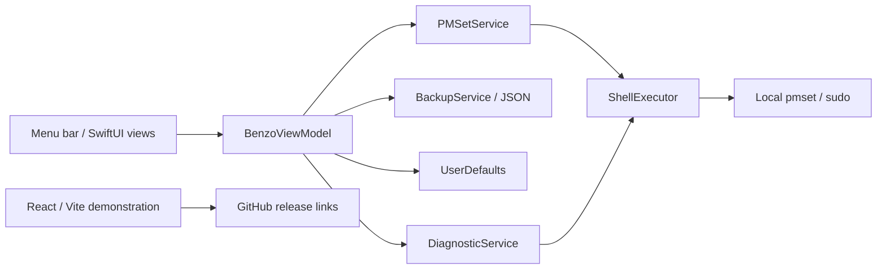

# Benzo evaluation — Phase 1, October 25, 2026

## Executive verdict and purpose

Benzo is intended as a small local macOS menu bar utility for selected sleep settings, wake diagnostics and restoration. Its implementation/release exist; the website builds and 20 Swift sources compile through a limited fallback. Direct argv, typed models, atomic backups, a settings enum and security CI are useful foundations.

**The current implementation does not reliably uphold its central promise of reversible sleep control.** High-impact recovery mechanisms can lose or overwrite original settings, leave partial changes behind, misreport restoration, or reapply settings after the user turns Benzo off. Error guidance can worsen the loss if followed. A fresh dependency audit also fails. These deserve attention before expanding features, distribution or commercial scope.

If owner demand and dedicated-hardware evidence justify continued control, the recommended direction is **trustworthy, capability-aware local sleep control with explicit recovery and honest status**; smaller alternatives remain credible. Treat “zero drain,” universally dark USB ports, and uniform Intel/Apple Silicon behavior as unverified claims until qualified on supported hardware. The July revenue roadmap is historical analysis, not evidence that paid licensing, analytics or cloud services are now wanted.

This evaluation makes no implementation changes, issue writes, merges, deployments, credential changes or privileged sleep operations. The proposed dispositions below are review decisions only. It stops at the Phase 1 gate; it is not an implementation plan.

**Host constraint:** this Mac Mini runs multiple always-on fleets. Preserve every host setting; do not grant Benzo permission, change pmset, invoke generic Restore/Defaults, kill sleep blockers, or perform physical sleep tests here. Future privileged/hardware acceptance belongs on a dedicated test Mac. The audit stopped only its own temporary Benzo process; read-only power output matched before and after, with sleep disabled (`sleep 0`).

## Scope, evidence and baseline

Repository and GitHub main both resolve to `a0c12f1ddde45a36be2b89e603d3a4ae080871cd`. The working tree began clean. Review covered native code, React source, local state, distribution scripts, CI, dependencies, project documentation and all **56 currently open issues**. GitHub also has **three open dependency PRs**, [#92](https://github.com/chrisrogers37/benzo/pull/92), [#93](https://github.com/chrisrogers37/benzo/pull/93) and [#94](https://github.com/chrisrogers37/benzo/pull/94).

“Observed” means a command or bounded fixture was executed; “source-confirmed” means the mechanism follows from inspected code; “inferred” is a judgment requiring further evidence; “blocked/unverified” is not a passing result.

| Check | Result and practical limit |
|---|---|
| Host | Observed Darwin arm64, Swift 6.2, Node 25.9.0, npm 11.12.1; Command Line Tools available, full Xcode absent. |
| Dependency installation | `npm ci --ignore-scripts` passed after approved network access. Manifests/lockfile unchanged; lifecycle scripts intentionally not run. Initial build failed because dependencies were absent, not because JSX was invalid. |
| Landing production build | **PASS:** `npm run build`, Vite 8.2.2, 17 modules, 240.25 kB JavaScript / 73.89 kB gzip. Reported 63 ms is build execution time, not user load or interaction performance. |
| Dependency security gate | **FAIL:** `npm audit --audit-level=moderate`, exit 1, two high-severity packages: `source-map-js` 1.2.1 and Vite 8.2.2. These are development/build dependencies; production static-site exploitability was not established. No fixes applied. |
| Secrets | A constrained scan of 53 tracked text files found no matching token/private-key/credential patterns. Local gitleaks unavailable; no Git-history, ignored-file or comprehensive secret clearance claimed. |
| Standard native build | **BLOCKED:** `xcodebuild ... -configuration Debug ... CODE_SIGNING_ALLOWED=NO build` requires full Xcode. Project/resource/signing/archive/universal-build validation remains outstanding. |
| Native compilation fallback | **PASS, limited:** unchanged Swift sources compiled using `swiftc -swift-version 5 -target arm64-apple-macos13.0` and a scratch module cache. This bypasses the Xcode project and resources. |
| Native launch / setup screenshot | Temporary app with isolated `com.benzo.evaluation` identity launched; its process remained alive after 88 seconds. The user then supplied a screenshot showing Welcome to Benzo / Grant Permission and truncated explanatory text. This is user-observed setup UI evidence, separate from source identity/process evidence. Two native accessibility calls timed out for an unknown reason; permission was not granted and post-setup interaction remains unverified. |
| Browser | Local preview started, then stopped at the gate (owned session 97547, Ctrl-C, exit 130). The latest same-origin retry after renewed user authorization was also denied: “A saved user permission setting blocks this action.” No workaround was used. Screenshots, keyboard, responsive layout, console and Web Vitals remain **blocked**. |
| Safe parser fixture | Actual `PMSetState` omitted a tab-separated hibernatemode key and retained headers/annotations from synthetic input. This proves parser weaknesses, not that every real machine output is malformed. |
| Safe subprocess fixture | Actual `ShellExecutor` hung on a synthetic child emitting 1 MiB; a five-second supervisor timeout ended only the owned group. Confirms wait-before-drain deadlock, not its field frequency. |
| Privileged behavior / hardware | **Not run:** setup grant, sudoers installation, pmset writes, sleep/wake, caffeinate termination or login registration. No measured Intel/Apple Silicon/dock compatibility or battery result. |
| Released artifact | GitHub metadata confirms [v0.3.0](https://github.com/chrisrogers37/benzo/releases/tag/v0.3.0), published June 2, with a 624,510-byte DMG. Binary architecture, signature, notarization and clean-machine installation were not inspected. |

The evaluation identity had no active flag and `/etc/sudoers.d/benzo` was absent. The temporary app and preview were stopped; their recorded processes (94599, 94635 and 94904) were confirmed absent. No fleet process was touched. Power snapshots remained byte-identical: sleep/disksleep/standby/powernap/lowpowermode 0; womp/tcpkeepalive/autorestart/ttyskeepawake 1; displaysleep 15. This is observation, not authorization to rewrite the baseline. GitHub CLI authentication succeeded with approved network; the initial sandbox failure was environmental.

The last observed scheduled security run at this exact main SHA [failed October 19](https://github.com/chrisrogers37/benzo/actions/runs/39313494780). On October 18, PR #92's [security run passed](https://github.com/chrisrogers37/benzo/actions/runs/39156203361), while #93 and #94 failed. Those dated runs are not current comprehensive acceptance: the workflow has no native/frontend build or behavioral test gate (`.github/workflows/security.yml:13`). Fresh main audit failure supersedes any blanket “CI is green” claim. PRs require separate current-head review before any merge decision.

## System, code and data map



The native app and website are separate products sharing a manually maintained visual/behavioral contract, not a live service connection.

| Boundary | Responsibilities and evidence |
|---|---|
| Native entry and presentation | `Benzo/Benzo/App/BenzoApp.swift:3` delegates to AppKit. `AppDelegate.swift:11` owns the status item/popover; opening it starts drift correction at `:102`. Views call one observable view model. |
| State orchestration | `Benzo/Benzo/ViewModels/BenzoViewModel.swift:5` owns activation, recovery, setup, timers, diagnostics and login registration. Desired preferences and applied system state are not separated. |
| Settings and command policy | Five logical settings map to seven pmset keys in `Benzo/Benzo/Models/SleepSetting.swift:42`. Four settings default on; disabling TCP keepalive is opt-in at `:32`. Services directly spawn argv-based processes. |
| Persistent recovery | `OriginalSettingsBackup.swift:3` stores one unscoped dictionary plus capture time. `BackupService.swift:15` atomically writes user-local `original-pmset.json`; file existence, not validity, controls reuse. |
| Other state | UserDefaults contains active/preferences and sudoers version; the root-owned rule is machine-wide. Diagnostic sessions/devices/blockers are ephemeral. No application database, server API or cloud backend participates. |
| Website | `src/main.jsx:4` → `src/App.jsx:4` → the 1,370-line `src/BenzoHybrid.jsx`. It owns local demo state, fixed diagnostic fixtures, copy and inline styling. GitHub links and external Google Fonts are the relevant web integrations. |
| Delivery | `scripts/build-dmg.sh:24` archives, exports, optionally notarizes and packages. `Casks/benzo.rb:1` describes 0.3.0. Security CI runs npm audit/gitleaks; Dependabot watches npm/actions. |

The critical state flow is read current pmset → save baseline if absent → apply sequential `-a` writes → mark active. Restore decodes saved values and writes them back with `-a`. The read captures current power-source settings, while `-a` targets all power sources. User-local recovery records also govern changes to shared system policy. Timers and asynchronous drift checks create additional writers to that same state.

## What works, what is broken, and what remains unknown

| Capability | Assessment | Evidence |
|---|---|---|
| Native and landing implementation | Real, limited compilation/build observed | Swift fallback and Vite build above; source entrypoints exist. |
| Controlled command construction | Useful foundation, incomplete authorization boundary | Direct argv at `ShellExecutor.swift:94`; backup validation at `PMSetService.swift:56`; sudoers wildcard remains too broad. |
| Original-settings recovery | **Broken on several reachable branches** | Flat backup, partial writes, suppressed load/restore errors and absent termination integration. |
| Active/timer state | **Source-confirmed inconsistencies** | Persisted requested state appears verified; stale drift callback and uncancelled sleep work can act after deactivation. |
| Diagnostics | Implemented, reliability/meaning incomplete | Pipe fixture deadlock; read errors become empty data; disabled settings can display “verified.” |
| Signing/install path | Release metadata exists; trustworthy install unproven | App directory submitted to notarytool; signature not inspected; advertised personal tap unavailable through connected GitHub lookup. |
| Website UX | Static defects confirmed; live appearance unverified | Pointer-only controls, low contrast, wrong OS requirement, fixed timer simulation, absent social image. |
| Runtime performance | **No measured field conclusion** | Browser blocked; no profiling. Small bundle/lists do not justify speculative memoization or code splitting. |

## Ranked findings and implications

Severity reflects supported impact, not fix effort. Independent branch refutation and six completed critiques support the qualified mechanisms below; none was exercised against live power settings.

### High: reversibility and recovery

1. **Distinct power-source originals can be lost.** `Benzo/Benzo/Services/PMSetService.swift:19` reads `pmset -g`; `OriginalSettingsBackup.swift:4` cannot retain separate battery/AC values; apply/restore use `-a` at `PMSetService.swift:27` and `:76`. If applicable profiles have different managed values, an apparently successful round trip overwrites their differences. Only model-managed keys are affected; single-profile/equal-value cases do not lose distinct values. Capture/restore must preserve source identity; lost originals cannot be reconstructed from a flat legacy file. Expand #54 alongside #66.

2. **Partial writes can survive failed activation.** `PMSetService.swift:24` stops at the first failing command, while `BenzoViewModel.swift:260` marks active only after the batch succeeds. This requires at least one successful changing write before a later failure; failures before writes do not establish residual changes. An error is shown, but Off remains inaccurate and Quit skips recovery (`:118`). Explicit Restore can recover with a valid backup/permission; “no in-app recovery” overstates the defect. #57 is canonical, coordinated with #36.

3. **Invalid recovery data can produce false Off and hazardous repair advice.** Master deactivation at `BenzoViewModel.swift:273` suppresses load errors and switches off. Explicit Restore preserves state but misreports unreadable/corrupt data as “activate Benzo first” (`:101`–`:103`); activation trusts file existence (`:255`). Both restoration controls accept backups omitting changed keys (`PMSetService.swift:72`). Worse, `PMSetService.swift:9` advises deleting the sole backup and reactivating after an invalid value. If settings remain changed and other originals are salvageable, following that advice erases evidence and recaptures modified state. The code does not itself delete the file; the hazard requires the user to follow the instruction. Preserve/export recovery evidence and identify unresolved values; deletion/reactivation is not generic recovery. Extend #54/#55/#66 and error reporting #76.

4. **Quit recovery is best-effort and bypassable.** `BenzoViewModel.swift:117` ignores backup/restore failures then terminates. The footer is the sole caller; `AppDelegate.swift:4` has no termination hook. Graceful termination needs a shared policy; crashes/SIGKILL need next-launch reconciliation rather than an impossible guaranteed shutdown callback. Keep #53/#56 with corrected acceptance.

5. **A stale drift callback can undo successful deactivation.** `BenzoViewModel.swift:193` checks active before background work; `:220` later reapplies without checking active state or operation identity. Deactivate can restore in between (`:280`), leaving a mismatching read and currently enabled preference to cause writes while UI says Off. The callback recomputes current preferences; no-drift, already-inactive, all-disabled and correction-before-restore branches limit the claim. Coordinate writers and invalidate stale work. Add this race to #61/#79.

6. **Repeat use can restore an obsolete baseline.** `BenzoViewModel.swift:255` saves only when the file is absent and `:280` leaves it after restoration. Complete session A, change a managed OS setting while Off, then complete session B: B restores A's old value without any command failure. Group #66 with P1 recovery work. Retire/replace a baseline only after resolved recovery; never overwrite the only original record during an interrupted operation.

**Ownership remains a separate contract:** full restore writes every managed key present in the backup (`PMSetService.swift:70`–`:76`), including keys this session never changed. For example, TCP keepalive defaults disabled in Benzo's selection (`SleepSetting.swift:34`–`:37`), yet restore can overwrite an intervening external change to it. Profile-aware or fresh snapshots alone do not resolve competing writers. Decide whether recovery owns all managed keys or only session changes, and how to handle later external changes.

### High operational priority: the security gate is currently failing

The fresh dependency scan reports high advisories in locked `source-map-js` 1.2.1 (`package-lock.json:766`) and Vite 8.2.2 (`:793`), including GHSA-68fv-2mgg-jv7q and six Vite advisory identifiers recorded by npm. This is a current remediation candidate distinct from completed #25's Vite-major upgrade. Evaluate existing dependency PRs against the actual lockfile/advisories and rerun required checks; neither an old passing PR run nor a major-version number establishes security. No automatic upgrade or merge is authorized by this report.

### Medium: authorization, native reliability and distribution

| Finding | Evidence, impact and supported direction |
|---|---|
| Sudoers numeric wildcard exceeds intended scope | `ShellExecutor.swift:80` uses `[0-9]*`; sudo matches joined arguments and `*` can cross whitespace. Another admin-user process can append additional pmset settings. This is broader passwordless pmset authorization, **not arbitrary shell execution/root file access**. Direct argv inside Benzo does not constrain other callers. Validate complete argument shape using a supported mechanism; #80 is related, closed #10 did not resolve this residual issue. [sudo manual](https://www.sudo.ws/docs/man/1.9.14/sudoers.man.pdf). |
| Subprocess output deadlock | `ShellExecutor.swift:99` waits before draining its pipe at `:102`; synthetic 1 MiB output reproduced a hang. Diagnostics reads full pmset logs/profiler output. Drain concurrently and bound cancellation/output. Expand #63; separate this from ordinary main-thread blocking. |
| Repeated permission repair | The health probe requests `sudo ... pmset -g` (`ShellExecutor.swift:43`), but the rule grants only sleepnow and `-a` writes (`:79`). Without unrelated cached authorization, a valid installation can repeatedly trigger repair; its errors are swallowed (`BenzoViewModel.swift:64`). Expand #64. |
| State/timer contract | Stored active state is trusted at startup (`BenzoViewModel.swift:37`); preferences persist before successful writes (`:93`). Deactivate/revert do not cancel the timer or 0.5-second delayed sleep (`:142`, `:160`). Timer expiry can reactivate; an actual terminated process cannot keep its timer alive. Correct #61/#62/#65/#68. |
| Notarization input is invalid | `scripts/build-dmg.sh:63` submits a `.app` directory before creating the DMG at `:77`; `set -e` aborts on failure. Apple requires supported archives. Export fallback copies the archive app (`:54`–`:57`), intended as community/ad-hoc output; its effective signature is not checked. Account enrollment alone is insufficient; retain explicit community versus notarized release modes. Consolidate #31/#42/#58/#59. [Apple notarization workflow](https://developer.apple.com/documentation/security/customizing-the-notarization-workflow). |
| Uninstall can remove recovery prerequisites | Cask quit/rule deletion (`Casks/benzo.rb:14`) has no verified-restoration prerequisite; zap also targets the backup directory (`:17`). If changes remain, deleting the rule removes the in-app grant needed to restore, and zap may erase originals. Actual Homebrew ordering/behavior is untested: conditional source risk, not reproduced loss. Expand #75 with #53/#56. |
| Verification and observability gaps | CI never compiles either product (`security.yml:13`). Pure parser/policy/recovery behavior has no automated suite. Diagnostic errors collapse to empty results (`DiagnosticService.swift:23`, `:79`); inactive/disabled settings become matching (`:140`). Focus #71/#72/#76/#78 on actual failure detection. |

### Medium and low: structure, documentation and website UX

| Finding | Evidence and consequence |
|---|---|
| Native setup disclosure truncated — M | User-supplied screenshot shows the Grant Permission action while its explanation ends at “can adjust sleep settings without...” in faint text. The complete existing explanatory text exists at `Benzo/Benzo/Views/SetupView.swift:42`–`:45`, but is not complete authorization disclosure. Popover sizing (`AppDelegate.swift:22`, `:27`, `:44`) is a candidate cause, not proven root cause. Explain the persistent machine-wide `%admin` grant (`ShellExecutor.swift:83`), that Off/Quit do not revoke it, and the removal route. No post-grant UI was tested. “Restore System Defaults” (`FooterView.swift:32`, Web:962) actually restores saved originals (`VM:106`), not factory defaults. |
| Keyboard/accessibility exclusion — M | Mockup controls and install-help disclosure are click-only div/span elements (`src/BenzoHybrid.jsx:611`, `:872`, `:1266`), without role, keyboard or state semantics. Download nests button inside anchor (`:1210`). Replace with appropriate controls; #81. Browser interaction remains unverified, but source semantics are decisive. |
| Low text contrast — M | Feature body #aaa/white is 2.323:1 (`:1105`); white/pink 14px CTA is 3.098:1 (`:1221`); hero #999/warm-white is nominally 2.615:1 (`:202`). Ratios calculated from source colors, not screenshot pixels. Important descriptions include the Find My warning. Preserve brand while improving readable text/action variants; #43. |
| Incorrect demo behavior — M | Sleep Now and every timer option render literal “Sleeping in 4:32” (`:679`, `:696`, `:715`); off-state sleep does not activate. Native distinguishes immediate sleep and selected duration (`SleepNowButton.swift:61`, `:81`, `:117`). Diagnostic fixture also falsely flags default-disabled TCP keepalive (`BenzoHybrid.jsx:512`). #81 should cover behavior, not just pixels. |
| Wrong platform and command guidance — M | Website says Catalina+ (`:1195`), while project deployment target is 13.0 (`project.pbxproj:287`). README `:26` and website `:1154` omit default `womp 0` and include opt-in `tcpkeepalive 0`, which the UI warns disables Find My. Correct executable advice as well as wording. |
| Coupled frontend surface — M | One component embeds state, fixtures, commands, marketing and styling (`BenzoHybrid.jsx:6`, `:502`, `:843`, `:1154`); duplicated representations already disagree. #22 can establish useful boundaries, but large file size alone is not a runtime performance defect. |
| Documentation/distribution clarity — M/L | MIT is advertised (`README.md:68`) without a tracked license; no SECURITY.md. Active AGENTS guide still says Vite 6/Node 20+, while lockfile requires `^20.19.0 || >=22.12.0` (`package-lock.json:810`). Google Fonts requests belong to the website, so local-only privacy claims must distinguish it from the app. |
| Polish and metadata — L | No reduced-motion override for infinite bounce (`BenzoHybrid.jsx:1018`); /og-image.png is referenced (`index.html:13`, `:19`) but absent from public assets; unused activeCount (`BenzoHybrid.jsx:25`). These are not release-safety blockers. |

No frontend performance regression is confirmed: finite event updates, small fixed lists, no fetch/effect loop or observer leak. Blur, font reflow, mobile clipping and latency require browser evidence. Memoization, code splitting, self-hosted fonts and deployment redesign are not mandatory without demonstrated need.

## Open-issue triage — all 56, once each

Priorities: **P1** safety/security/release correctness; **P2** medium correctness, access or verification; **P3** optional cleanup/product choice. I/E/R = impact/effort/change risk, H/M/L. “Done,” “duplicate,” “stale” and “defer” are proposed dispositions, not tracker mutations. Duplicate rows link to a canonical issue while preserving useful acceptance criteria.

For compact source references in this table: **VM** = `Benzo/Benzo/ViewModels/BenzoViewModel.swift`; **PM** = `Benzo/Benzo/Services/PMSetService.swift`; **Shell** = `Benzo/Benzo/Services/ShellExecutor.swift`; **Diag** = `Benzo/Benzo/Services/DiagnosticService.swift`; **Web** = `src/BenzoHybrid.jsx`; other filenames resolve under the component paths above.

| Issue / topic | Disposition / priority | I/E/R | Current evidence and correction |
|---|---|---|---|
| [#20](https://github.com/chrisrogers37/benzo/issues/20) package version | Stale target, P3 | L/L/L | package.json:4 is 0.1.0; native/cask now 0.3.0. Do not apply old 0.2.1 instruction. Decide independent site version policy; overlaps #82. |
| [#21](https://github.com/chrisrogers37/benzo/issues/21) pink constants | Defer into [#22](https://github.com/chrisrogers37/benzo/issues/22), P3 | L/L/L | Web:653/:662 duplicate shadows; other alpha values have distinct intent. Mechanical cleanup is not HIGH severity. |
| [#22](https://github.com/chrisrogers37/benzo/issues/22) mockup extraction | Keep under #81, P2 | M/M/M | Web is 1,370 lines; hint at :991 controls mockup from outside it. Preserve that caller; avoid blind state relocation. |
| [#23](https://github.com/chrisrogers37/benzo/issues/23) Swift constants | Defer/dedupe #82, P3 | L/L/L | FooterView:26 already displays 0.3.0. Bundle-derived version is useful; mass constant extraction is optional. |
| [#24](https://github.com/chrisrogers37/benzo/issues/24) style scales | Defer with #21/#22, P3 | L/M/L | Repeated Web labels :340/:414/:445/:491; avoid changing visual values during mechanical extraction. |
| [#25](https://github.com/chrisrogers37/benzo/issues/25) Vite 6→8 | **Done in source**, P3 | L/L/L | package.json:16–17 already plugin 6/Vite 8; build passes. Browser acceptance blocked. Current advisories are separate from this completed upgrade. |
| [#26](https://github.com/chrisrogers37/benzo/issues/26) DateFormatter cache | Defer, P3 | L/L/L | DiagnosticView:260–269 allocates formatters; five sessions bound work. No measured native slowdown. |
| [#27](https://github.com/chrisrogers37/benzo/issues/27) index keys | Close/defer no defect, P3 | L/L/L | Web:351/:456/:502/:1050 arrays have fixed order and presentation-only rows; no identity bug demonstrated. |
| [#28](https://github.com/chrisrogers37/benzo/issues/28) imperative hover | Rewrite/defer, P3 | L/L/L | Web:656/:881 mutates styles. Generic “every rerender wipes hover” claim unsupported; require a specific reproduction before adding state. |
| [#29](https://github.com/chrisrogers37/benzo/issues/29) VM growth | Defer/no current action, P3 | L/L/M | 326 lines alone is not a defect. Recovery ownership may justify seams; coordinate #82 instead of mandated generic refactor. |
| [#30](https://github.com/chrisrogers37/benzo/issues/30) justify no tests | Retire/reframe, P2 | M/L/L | PMSetState:7 is pure and fixture-testable. Proposed “every interesting path requires root” rationale is false; align with #72. |
| [#31](https://github.com/chrisrogers37/benzo/issues/31) notarized distribution | Keep outcome, P1 | H/M/M | build-dmg.sh:63 is broken beyond account enrollment. Exact released signature unknown; use #58/#59 implementation scope. |
| [#32](https://github.com/chrisrogers37/benzo/issues/32) universal binary | Keep verification, P2 | M/L/M | Intel-only evidence concerned 0.2.1. Current 0.3.0 architecture unverified; Debug ONLY_ACTIVE_ARCH is not Release proof. |
| [#33](https://github.com/chrisrogers37/benzo/issues/33) Homebrew tap | Keep, P2 | M/M/L | README:15 advertises tap; connected lookup of homebrew-benzo returned 404. Publish verified route or correct instructions; no universal private-repo absence claim. |
| [#34](https://github.com/chrisrogers37/benzo/issues/34) release automation | Keep/defer, P2 | M/M/H | Only security workflow exists; build script :99 prints manual upload. Credentials/publishing require scoped authorization. |
| [#35](https://github.com/chrisrogers37/benzo/issues/35) auto-update | Defer, P3 | M/H/H | No updater/appcast code. Adds network/trust surface; depends on reliable release artifacts and product choice. |
| [#36](https://github.com/chrisrogers37/benzo/issues/36) interrupted activation | Keep/rewrite, P1 | H/M/H | VM:100 provides manual Restore when backup is valid. Missing automatic reconciliation remains; coordinate #53/#57. |
| [#37](https://github.com/chrisrogers37/benzo/issues/37) crash reports | Duplicate of [#76](https://github.com/chrisrogers37/benzo/issues/76), P2 | M/M/M | No reporting service. Preserve privacy choice; proposed custom signal collector is not validated crash coverage. |
| [#38](https://github.com/chrisrogers37/benzo/issues/38) SwiftLint/CodeQL | Defer, P3 | M/M/L | security.yml:13 only audit/gitleaks. Native build and focused behavior checks have clearer immediate value. |
| [#39](https://github.com/chrisrogers37/benzo/issues/39) custom domain | Defer owner choice, P3 | L/M/M | README:59/cask:8 use Vercel subdomain. No chosen/owned domain evidence; no purchase or DNS change implied. |
| [#40](https://github.com/chrisrogers37/benzo/issues/40) LICENSE/SECURITY | Keep disclosure; license→[#60](https://github.com/chrisrogers37/benzo/issues/60), P2 | M/L/M | Both files absent; MIT advertised. Disclosure channel remains distinct; private-reporting setting unverified. |
| [#41](https://github.com/chrisrogers37/benzo/issues/41) privacy/trust copy | Keep, P2 | M/M/L | PM:18, Diag:22/:79, BackupService:15, Shell:53 define local reads/writes. Website requests Google Fonts; scope claims accurately. |
| [#42](https://github.com/chrisrogers37/benzo/issues/42) Developer ID | Duplicate of [#31](https://github.com/chrisrogers37/benzo/issues/31), P1 | H/M/M | Same trusted-install outcome; do not promise literally zero Gatekeeper dialogs from signing alone. |
| [#43](https://github.com/chrisrogers37/benzo/issues/43) contrast | Keep canonical, P2 | M/L/L | Web:1105 gives 2.323:1; CTA :1221 gives 3.098:1. Link #81; old version examples do not negate issue. |
| [#51](https://github.com/chrisrogers37/benzo/issues/51) filing test | Close test artifact, P3 | L/L/L | Body is “test”; historical index explicitly identifies cleanup. |
| [#52](https://github.com/chrisrogers37/benzo/issues/52) BZ-001 test | Duplicate of [#53](https://github.com/chrisrogers37/benzo/issues/53), P3 | L/L/L | Placeholder “Test body”; real lifecycle scope is #53. |
| [#53](https://github.com/chrisrogers37/benzo/issues/53) termination recovery | Keep/narrow, P1 | H/M/H | AppDelegate lacks hook; VM:117 restores only footer path. Graceful termination plus next-launch recovery; no SIGKILL guarantee. |
| [#54](https://github.com/chrisrogers37/benzo/issues/54) backup parser | Keep/expand, P1 | H/M/H | Tabs/annotated values matter; irrelevant headers filtered at PM:70. Add per-profile loss/coverage and hazardous PM:9 delete/reactivate advice; preserve salvageable originals. |
| [#55](https://github.com/chrisrogers37/benzo/issues/55) false Off | Keep, P1 | H/M/H | VM:273 hides failure; :102 mislabels corruption “activate first”; PM:72 skips keys and :9 advises deletion. Preserve evidence; default reset differs from originals. |
| [#56](https://github.com/chrisrogers37/benzo/issues/56) quit errors | Keep with #53, P1 | H/M/H | VM:117–121 suppresses failures and exits. One observable retry/quit-anyway policy, not duplicate recovery machinery. |
| [#57](https://github.com/chrisrogers37/benzo/issues/57) partial apply | Keep canonical, P1 | H/H/H | PM:24 sequential writes, VM:260 post-success active flag; rollback itself must remain recoverable. |
| [#58](https://github.com/chrisrogers37/benzo/issues/58) notarization pipeline | Keep under #31, P1 | H/M/M | Script:63 wrong input; :57 copies archive app without checking its signature. Consolidate #59; missing teamID alone not proven fatal. |
| [#59](https://github.com/chrisrogers37/benzo/issues/59) hardened runtime | Keep/narrow with #58, P1 | H/L/M | No explicit hardened-runtime setting; inspect effective Release signature. Empty entitlements file is not inherently required. |
| [#60](https://github.com/chrisrogers37/benzo/issues/60) license strategy | Keep owner decision, P2 | M/M/M | README:68 claims MIT; license absent. Canonical overlap with #40; monetization not ratified. |
| [#61](https://github.com/chrisrogers37/benzo/issues/61) startup state | Keep/expand, P1 | H/M/H | VM:37 trusts stored flag; clean Quit does not clear it. Add stale async drift acceptance, not blind reapply. |
| [#62](https://github.com/chrisrogers37/benzo/issues/62) checkbox failure | Keep, P2 | M/M/M | VM:93 persists before apply; :298 does not revert. Model desired/applied state, including partial writes. |
| [#63](https://github.com/chrisrogers37/benzo/issues/63) blocking commands | Keep/correct, P1 | H/H/M | Some reads use global queues, so “all on main” is false. Shell:99 deadlock reproduced; main-thread mutations still block. |
| [#64](https://github.com/chrisrogers37/benzo/issues/64) unexplained reinstall | Keep/expand, P2 | M/M/M | Shell:43 probe absent from :79 allowlist. Prompt is visible; repair failure/result is silently lost. |
| [#65](https://github.com/chrisrogers37/benzo/issues/65) empty active state | Keep contract, P2 | M/L/M | VM:260 allows no enabled settings; MasterToggleView:11 still says Deep Sleep On. Define protection semantics. |
| [#66](https://github.com/chrisrogers37/benzo/issues/66) stale backup | Keep, P1 | H/M/H | VM:255 reuses first-session originals; repeat use can overwrite intervening preferences. Preserve unresolved baselines; reject PM:9 deletion/reactivation advice. |
| [#67](https://github.com/chrisrogers37/benzo/issues/67) non-admin setup | Keep/narrow, P2 | M/L/M | Shell:25 checks shared file; :83 grants %admin. Admin is documented requirement; accurate eligibility is needed, standard-account support is a separate choice. |
| [#68](https://github.com/chrisrogers37/benzo/issues/68) pending timer | Keep/correct, P2 | M/M/M | VM:160 survives deactivate/revert, not actual process exit. Combine cancellable 0.5-second delay from #79. |
| [#69](https://github.com/chrisrogers37/benzo/issues/69) missing tap | Duplicate of [#33](https://github.com/chrisrogers37/benzo/issues/33), P2 | M/L/L | Same advertised route/current unavailable lookup. |
| [#70](https://github.com/chrisrogers37/benzo/issues/70) release automation | Duplicate of [#34](https://github.com/chrisrogers37/benzo/issues/34), P2 | M/M/H | Same absent tag-to-artifact pipeline. |
| [#71](https://github.com/chrisrogers37/benzo/issues/71) build CI | Keep, P1 | H/M/L | security.yml lacks builds. Current limited compile passes; gap is missing regression gate, not proven uncompilable main. |
| [#72](https://github.com/chrisrogers37/benzo/issues/72) behavioral checks | Keep focused, P2 | M/M/L | Parser/policy/recovery fixtures can run without changing pmset. Avoid arbitrary coverage targets or mirror tests. |
| [#73](https://github.com/chrisrogers37/benzo/issues/73) social image | Keep/lower priority, P3 | L/L/L | index.html:13/:19 point to absent asset. Production 404 not rechecked; a SPA HTML fallback would also not be an image. |
| [#74](https://github.com/chrisrogers37/benzo/issues/74) shared settings | Keep/correct, P2 | M/M/M | `-a` means all power sources, not all users. Policy is system-wide while backups are user-local; disclose and define ownership. |
| [#75](https://github.com/chrisrogers37/benzo/issues/75) uninstall | Keep/narrow, P2 | M/M/H | Cask:14 removes grant without verified-restoration prerequisite; :17 zap targets originals. Conditional recovery-loss risk; actual ordering untested. Direct DMG grant removal still lacks UI; coordinate #53/#56. |
| [#76](https://github.com/chrisrogers37/benzo/issues/76) observability | Keep canonical, P2 | M/M/L | VM:64/:119 and Diag:23 swallow context; PM:9 advises destructive repair. Prioritize accurate recovery guidance/local evidence; absorb #37 without mandatory telemetry. |
| [#77](https://github.com/chrisrogers37/benzo/issues/77) Sparkle | Duplicate of [#35](https://github.com/chrisrogers37/benzo/issues/35), P3 | M/H/H | Delivery absent; existing launch-time rule migration is a different function. |
| [#78](https://github.com/chrisrogers37/benzo/issues/78) diagnostics | Keep/split certainty, P2 | M/M/M | False “verified,” empty-on-error and UserActivity→Power Button ordering confirmed. USB Apple Silicon failure/log-variant coverage remain hypotheses. |
| [#79](https://github.com/chrisrogers37/benzo/issues/79) lifecycle umbrella | Keep/narrow, P1 | H/H/H | Consolidate missing keys/timers with #54/#55/#68; add drift race. Caffeinate scope is policy; popover leak/hardware failure not established. |
| [#80](https://github.com/chrisrogers37/benzo/issues/80) security umbrella | Partly stale/re-scope, P2 | M/M/M | Vite major done; current advisories persist. .env ignore missing, no leak observed. Track exact sudoers glob separately; recovery completeness belongs with native work. |
| [#81](https://github.com/chrisrogers37/benzo/issues/81) landing umbrella | Keep/reconcile, P2 | M/M/M | OS, keyboard, timer parity persist; link #22/#43/#73. Missing vercel.json alone is not a demonstrated deployment defect. |
| [#82](https://github.com/chrisrogers37/benzo/issues/82) Swift debt | Narrow/defer, P3 | L/M/M | Dedupe #20/#23/#29. Unused parameters exist; color currently matches theme. Empty Settings/IUO risks need reachable evidence, not mandatory broad refactor. |

Additional corrections inside umbrellas matter: `SleepSession.swift:38` matches generic User before UserActivity at `:43`; disabled diagnostics “verified” does not prove restoration; launch-at-login failure can leave the binding ahead of OS state (`VM:313`); AppleScript status 1 is overclassified as cancellation (`Shell:142`). Normal popover close removes its monitor (`AppDelegate.swift:118`), so an unproven alternate leak should remain a hypothesis. Deleting the cask or licensing decision's remaining scope merely to reduce issue count would lose real work.

## Capability-grounded direction and Phase 1 gate

**Conditional direction:** a continuing controller needs understandable requested/observed state, recoverable per-profile originals, explicit permission scope and honest diagnostics. Preserve the compact utility if demand and hardware benefit justify it; historical monetization plans do not decide that question.

The proposed north star is: **a user can request sleep, understand the result, and return to prior settings without guessing.** Existing models support bounded options. Scores below are provisional technical judgments, not measured demand, user value or delivery estimates. Assume an owner/public Mac user trying to explain unwanted wake or make occasional repeatable sleep requests; that user/job needs confirmation. These are choices, not an approved backlog.

| Opportunity | Existing anchor / additional scope | I/E/R |
|---|---|---|
| Read-only preflight | Present blockers, selected settings and pending timer together; distinguish supported/unsupported/unknown capabilities using `DiagnosticService.swift:106` and `SleepSetting.swift:42`. Hardware qualification is still required. | H/M/M |
| Last-operation receipt | Explain changed keys, apply/restore result and unresolved mismatch; extends `PMSetService.swift:24` and backup/verification models with truthful local result state. | H/M/M |
| Local diagnostic export | Let users inspect/select a report of existing sessions, devices, blockers and errors before sharing; no automatic upload. Process/device names and timestamps need visible inclusion controls. | M/L/L |
| Named presets | Reuse current enum/preferences with explicit network/Find My consequences. Useful only after reliable apply/restore; no universal zero-drain preset claims. | M/M/M |
| Configuration-aware history | Requires bounded durable local event storage and wake observation beyond today's transient sessions; measured battery/time differences must not be presented as proof of causation or actual hibernation. | M/M/M |
| Scoped sessions / Shortcuts | Require durable operation identity, cancellation and one shared command/recovery boundary. No public automation API exists today; added entrypoints carry high risk until core controls are dependable. | H/H/H |

For a user checking before sleep, preflight/receipts target uncertainty; for a user seeking support, export/history target evidence; for repeat users, presets/Shortcuts target routine effort. Those assumed jobs do not prove demand. Defer cloud dashboards, remote control, plugin systems, telemetry and payment infrastructure.

| Direction | Tradeoff / what would favor it |
|---|---|
| Repair persistent automatic control | Retains convenience but owns races, shared policy and qualification cost; favor only with demonstrated demand for enforcement and meaningful hardware benefit. |
| Smaller explicit-action controller | Retain diagnostics and bounded user-requested changes; remove implicit writes on popover open and automatic blocker killing. Less hidden ownership, less unattended convenience; favor occasional-control users. |
| Read-only explainer or maintenance-only | Avoid new privileged-control exposure while capability/demand is uncertain; loses one-click forced sleep and still needs correct diagnostics. Existing installations retain a recovery obligation—never abandon their originals. |

The recommendation changes if target hardware gains little benefit, users prefer occasional explanation, or ongoing OS qualification costs exceed value. Built-in/manual workflows are a comparison candidate, not proven adequate here. No interviews, adoption study or willingness-to-pay evidence was collected.

**Phase 1 gate:** review and accept or correct this assessment before any Phase 2 planning or implementation. The remaining questions are decisions, not an ordered epic:

- Is this an owner utility or a public product, which user/job is demonstrated, and what benefit would justify retaining automatic control? Which hardware outcomes qualify the supported scope?
- What should Off, Restore and Quit mean after partial failure? Does recovery own all managed keys or only session changes, and how should it handle competing changes and interrupted operations?
- Should scheduled sleep kill unrelated caffeinate sessions, or require a clearer opt-in policy? Should standard accounts be supported or accurately excluded?
- Is the desired distribution free/open-source, paid convenience, or another model; which license and support channel express that decision?
- Is signing/notarization now in scope, and which dedicated test Mac can verify full Xcode build, native UI, exact-release installation and privileged sleep without touching this always-on fleet host?
- Should browser verification resume once the saved permission policy is changed, or remain a recorded acceptance gap for the next phase?

No owner answer, implementation authorization or expansion into accounts, telemetry or monetization is assumed.

## Adversarial Review Findings

Six independent perspectives—Architect, Skeptic, Operator, User, Counter-Planner and Contrarian—reported no blocker to using the corrected assessment for an owner decision. **Eight consolidated document corrections** are resolved below. Checked items mean **document corrected**, not product implementation or acceptance complete; those risks remain open.

- [x] Added hazardous delete/reactivate advice and misleading “activate first” errors.
- [x] Elevated stale-baseline recovery to P1 while preserving unresolved originals.
- [x] Added untouched-key ownership and competing-change decisions.
- [x] Added conditional uninstall loss of recovery prerequisites; preserved runtime uncertainty.
- [x] Distinguished readable setup text from persistent `%admin` authorization disclosure, and saved originals from system defaults.
- [x] Corrected archive-copy signing claims; retained compile/fixture/hardware distinctions.
- [x] Marked opportunity estimates provisional and compared explicit-action, read-only and maintenance alternatives.
- [x] Recorded minimal portable evidence and retained handoff ownership below.
- [ ] Owner selects intended users, supported outcomes, recovery/permission semantics and product direction.
- [ ] Browser acceptance, full Xcode/release acceptance and dedicated-Mac privilege/hardware checks remain open; no fleet-host sleep testing.
- [ ] Final owner acceptance remains pending. No fixes, issue changes or next-phase work are implied.

## Evidence appendix and retained handoff

Observed October 25 at the pinned SHA; command results are session records, not reconstructed raw logs. Exact recorded command forms:

| Command | Recorded result |
|---|---|
| `npm ci --ignore-scripts` (task-local cache) | Exit 0; 20 installed / 21 audited. |
| `npm run build` | Exit 0; 17 modules; JS 240.25 kB / gzip 73.89 kB. |
| `npm audit --audit-level=moderate` | Exit 1; two high packages. |
| `npm run preview -- --host 127.0.0.1 --port 4173 --strictPort` | Started; browser denied; owned session stopped, exit 130. |
| `xcodebuild -project Benzo/Benzo.xcodeproj -scheme Benzo -configuration Debug -derivedDataPath /private/tmp/benzo-evaluation.ZF5P4x/DerivedData CODE_SIGNING_ALLOWED=NO build` | Exit 1: full Xcode required. |

Swift fallback recorded flags were `-swift-version 5 -target arm64-apple-macos13.0`, all 20 unchanged sources, scratch module cache, exit 0; complete shell argv is not retained in the summary. npm advisory IDs: source-map-js **GHSA-68fv-2mgg-jv7q**; Vite **GHSA-698v-4r3x-3vcv**, **GHSA-r825-w8mm-5pxw**, **GHSA-587h-7wmj-h5pm**, **GHSA-9jrq-w75r-8gcw**, **GHSA-rq7h-c2jc-7f22**, **GHSA-vfpm-58rq-9qcg**. Full raw audit JSON is not attached; these are the captured advisory results.

Safe parser fixture input, passed to unchanged `PMSetState(parsing:)`:

```swift
let input = "System-wide power settings:\nCurrently in use:\n hibernatemode\t3\n sleep                1 (sleep prevented by powerd)\n powernap             1\n"
```

Observed: hibernatemode absent; headers became dictionary keys; sleep annotation retained. Pipe fixture called unchanged ShellExecutor:

```swift
let output = try ShellExecutor.runDirect("/usr/bin/python3", ["-c", "print('x' * 1048576)"])
print("drained bytes: \(output.utf8.count)")
```

It hung until the recorded five-second supervisor timeout terminated its owned group. The supervisor command is not retained in the summary; no invented invocation or live pmset reproduction is supplied.

**Deliberately retained active handoff:** `/private/tmp/benzo-evaluation.ZF5P4x/`, owned by the root agent (`/root`) of this chat at the approval gate for possible Phase 2/browser completion. It includes `runtime.md`, `parser/main.swift`, `pipe/main.swift`, both host-power snapshots, issue/live summaries and critiques. Do not delete during this handoff. OS temporary cleanup may remove it; this document preserves the key inputs/results and limits rather than promising permanent raw receipts. Repository source and issues remain unchanged.
